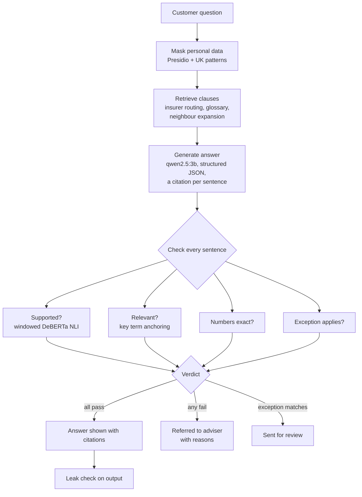

# Verified Policy RAG

A fully local question answering system over UK home insurance policy wordings, built so that customer data never leaves the machine and no unverified answer reaches a customer.

It runs on an 8 GB laptop with no cloud APIs. Every sentence of every answer is checked against the policy before a customer can see it, and anything that fails is referred to a human adviser instead.

---

## Why this exists

Insurers want to use language models on customer questions, but two things stop them:

1. **Data protection.** Customer data is sensitive, and sending it to models hosted outside the UK raises GDPR problems. The model has to run on infrastructure the insurer controls.
2. **Hallucination.** A model that confidently tells a customer they are covered when they are not creates complaints, mis-selling risk and regulatory exposure. Fluent and wrong is worse than silent.

So the question this project answers is not "can a model answer policy questions?" but **"can a small model that runs locally be made safe enough that a wrong answer never reaches a customer, and can we prove it?"**

---

## Results at a glance

Every expected answer was checked by hand against the policy PDFs.

| | Result |
|---|---|
| Wrong or misleading answers delivered to a customer | **0 of 39** questions |
| Bad drafts from the model caught (16 independent customer questions) | **11 of 11** (95% CI 74 to 100%) |
| Out of scope questions safely referred to an adviser | **9 of 9** |
| Personal data leaked | **0** |
| Retrieval: right page found (34 questions) | **94%** |
| Retrieval: right page found (16 independent customer questions) | **15 of 16** |
| Automated tests | **119** |

**The honest limitation.** On real customer questions the small local model is wrong more often than it is right, and the checks are deliberately cautious, so many correct drafts are also held back for an adviser. The system is currently safe rather than helpful. The details, and why, are in the evaluation section.

---

## Architecture



| Stage | Tool | Runs where |
|---|---|---|
| Parsing | Docling (layout aware, table structure) | Local |
| Embeddings | nomic-embed-text via Ollama | Local |
| Vector store | Chroma (persistent, cosine) | Local |
| Generation | qwen2.5:3b via Ollama | Local |
| Claim checking | cross-encoder/nli-deberta-v3-base | Local |
| Privacy | Microsoft Presidio + custom UK recognisers | Local |

---

## How it works, stage by stage

### 1. Reading the documents

Three insurers' public policy wordings: Policy Expert (40 pages), Uinsure (64 pages) and Covéa (74 pages), 182 pages in total.

* **Parsed with Docling**, with OCR off and accurate table structure, because these documents use two column layouts, icon tables and side by side "covered / not covered" columns that plain text extraction scrambles.
* **Every figure verified against a second reader.** Each amount, phone number, percentage and day count Docling extracted was cross checked against an independent extraction (pdfplumber). Across 182 pages the parser lost no figures and invented none.
* **One table could not be parsed.** The tier comparison table uses ticks and crosses as images, and the PDF's text layer stores different digits from those printed on the page. Docling returned an empty table. Those 28 rows were transcribed by hand, checked against the page image, and stored in `data/policy_expert_limits.csv`.
* **Printed page numbers are kept alongside PDF page numbers**, so a citation points to the page a reader would actually turn to.

### 2. Splitting into chunks

* Hybrid chunking that follows the document's headings, capped at **400 tokens**. The cap comes from the claim checker: DeBERTa reads at most 512 tokens and must fit a clause and a sentence together.
* **Generic headings fixed.** Policies introduce exclusions with headings like "We don't cover:". Treated as boundaries, these produced exclusion lists cut off from the cover they belong to. They are merged into the preceding cover, or labelled with it.
* **Every chunk labelled with its section** ("Section 2 Contents / Flood"), because the same cover name appears under buildings and contents with different exclusions.
* The hand checked table rows are written as plain sentences as well as table text, so they match how customers ask ("On Policy Expert Basic and Bronze, theft from vehicle is not covered").
* Result: 617 chunks.

### 3. Retrieval

Built up one measured step at a time (results in the evaluation section):

* **Insurer routing.** The insurer comes from the customer's policy, as it would in production. Only that insurer's chunks are searched, and brand names are removed from the query so they do not pull in brand heavy pages.
* **Neighbour expansion.** Each retrieved chunk brings the next chunk from the same section, because conditions are often printed on the page after the cover.
* **Glossary for vocabulary gaps.** Customers say "accidental damage" or "bike"; policies say "all risks" or "pedal cycle". Customer words are expanded to policy terms, but only words the policies themselves rarely use, because expanding common words caused query drift.

### 4. Privacy

* **Mask on the way in.** Names, emails, phone numbers and postcodes are replaced with placeholders before the question reaches the model or any log. The model does not need a name to answer a policy question.
* **Check on the way out.** Any personal data in an answer that does not appear in the policy marks the run unsafe.
* Presidio's defaults missed UK mobile numbers and have no UK postcode recogniser, so both were added and tested.

### 5. Generation

* qwen2.5:3b at temperature 0 with a fixed seed, using structured JSON output so every sentence carries citations.
* **The order of fields matters.** With the "not in policy" decision first, the model refused everything. It now lists relevant clauses first, writes the answer, and decides last.
* Instructions keep the policy's own terms ("a member of your family", not "your son"), one claim per sentence, so each sentence can be verified on its own.

### 6. Checking every sentence

| Check | What it catches | How |
|---|---|---|
| Citation | Uncited sentences, citations to clauses the model was never given | Structural |
| Supported | Claims the clause does not support | DeBERTa NLI, scored over windows of 1 to 8 sentences of the clause, best window counts |
| Miscitation repair | True facts citing the wrong clause | Re-checked against the other retrieved clauses; citation corrected, not blocked |
| Relevant | True sentences that do not answer the question | The question's specific words must appear in the evidence (not the sentence, because models echo the customer) |
| Numbers | Wrong amounts, limits, periods | Exact match against the cited clause |
| Exceptions | A rule quoted correctly when an exception applies to this customer | If a clause's "unless / except / you do not need to" matches the customer's situation, the answer goes to review |
| Privacy | Personal data in the answer | Presidio on the output |

**Verdict rules.** If any sentence fails, the whole answer is withheld. Delivering the passing sentences alone was tested and rejected: it once turned "Yes, but only if..." into an unconditional "Yes". When the model says something is not in the policy, the customer sees a fixed message, never the model's own refusal text.

---

## Evaluation and testing

### Test sets

| Set | Size | Written by | Purpose |
|---|---|---|---|
| Main retrieval set | 34 | Builder | Retrieval development |
| Glossary development set | 8 | Builder, with the glossary | Kept separate because it leaks the glossary |
| **Independent customer set** | **16** | **Written in customer voice, independently of the retrieval design** | **Headline results** |
| Document derived set | 23 | Written from the documents, including 9 out of scope runs and 2 with personal data | Answer quality, refusals, privacy |

### Retrieval

| Stage | Right page in top results (34 questions) |
|---|---|
| Baseline vector search | 74% |
| + insurer routing | 91% |
| + neighbour expansion (about 9 chunks) | 94% |
| + glossary (rare words only) | 94%, and no harm to precise questions |

The most important finding came from the independent questions. On six customer style questions, the same system scored **33%**. Every builder written question named the insurer; customers say "my policy". Supplying the insurer from the customer's policy, as production would, raised it to 100%. On the final 16 customer questions: **15 of 16** with the insurer known, **12 of 16** without.

### Answers

**Independent customer questions (16)**

| | Result |
|---|---|
| Wrong answers delivered | 0 |
| Bad drafts caught | 11 of 11 |
| Correct drafts wrongly withheld | 3 to 4 |
| Answers delivered | 2, both true, one incomplete |

**Document derived questions (23)**

| | Result |
|---|---|
| Wrong answers delivered | 0 |
| Correct answers delivered | 6, plus 2 true but incomplete |
| Correct drafts wrongly withheld or sent for review | 4 |
| Out of scope questions safely referred | 9 of 9 |
| Personal data leaked | 0 |

With samples this small, these are counts with wide uncertainty, not rates to quote alone.

### Experiments that did not work, and why they are recorded

| Experiment | Result |
|---|---|
| Embedding similarity to judge relevance | Relevant and irrelevant sentences overlapped (0.66 to 0.80); no threshold separates them. Replaced with key term anchoring. |
| A larger model (qwen3:4b) | Slightly better drafts (7 vs 6 acceptable of 16) but more than twice as slow. Kept the 3B model. |
| Customer policy details (tier, covers) as context | No measurable gain on its own. Kept for the interface. |
| Extract then answer (quote first, then answer) | Too complex a format for a 3B model; it left citations empty. Rolled back, but it exposed a real bug: refusal text was being shown unchecked. Fixed and tested. |

### Automated tests

119 pytest tests, including: every chunk within the checker's token limit; 30 known facts present in the right chunk; exclusions kept with their cover; retrieval recall floors on every test set; the NLI checker scoring textbook cases correctly before it is trusted; personal data masked; insurer names never masked; refusals never showing model text; and the exception rule.

---

## What I learned

1. **Test questions written by the builder hide the biggest failures.** My questions named the insurer; customers do not. 94% became 33%.
2. **Supported is not the same as correct.** An answer about freezer food listed five true sentences about frozen pipes. Every sentence passed a grounding check.
3. **Test the checker before trusting it.** The NLI model scored a near copy of the source as unsupported. Four textbook cases showed the model was fine and the input was the problem: it needed short windows, not whole clauses.
4. **A true answer can still be wrong.** A customer refitting a kitchen was told to notify the insurer, quoting the policy exactly. The next line exempts kitchen refits. My answer key missed it too.
5. **Blocking part of an answer can make it more misleading.** Hence: any failed sentence withholds the whole answer.
6. **Privacy masking can change meaning.** "Will Covéa reimburse me?" was masked as a person's name, and the answer went off track.

Full engineering notes, with every problem in general terms, its cause, fix and evidence, are kept separately.

---

## Limitations

* **The generator is the bottleneck.** A 3B model is what fits on 8 GB. About two thirds of failures on customer questions are the model choosing the wrong clause. The checks are independent of the model and would sit unchanged in front of a larger one on a server.
* **Omissions are only partly caught.** The exception check catches an exception that matches the customer's words; it does not catch every important omission.
* **The NLI checker can miss a reversed meaning** when wording overlaps heavily (seen twice).
* **The checks are cautious.** Correct answers are sometimes withheld.
* **Street addresses are not masked** by the small privacy model used for speed.
* **Small evaluation sets.** 16 independent questions give wide confidence intervals.

## Next steps

* A larger local model on server hardware, with the same checks.
* A local reranker and BM25 keyword search (both local, no cloud services) to reduce distracting clauses.
* Fine tuning the NLI checker on insurance examples, using the cases this evaluation labelled.
* An adviser view: withheld answers shown to a human with each sentence marked verified or blocked, and why.

---

## Repository layout

```
app/
  retrieve.py    insurer routing, neighbour expansion, retrieval
  glossary.py    customer words to policy terms, rare words only
  generate.py    local generation with structured, cited output
  checks.py      every check, the verdict, exceptions
  privacy.py     masking and leak detection
  profile.py     customer policy details as a citable clause
ingest/
  parse.py         Docling parsing
  check_numbers.py figure verification against a second reader
  chunk.py         chunking, sections, hand checked table rows
  index.py         embedding and indexing into Chroma
eval/
  retrieval_recall.py  retrieval evaluation with confidence intervals
  show_retrieval.py    per question retrieval inspection
  answer_check.py      full pipeline evaluation
tests/             119 automated tests
data/              hand checked limits table, synthetic claims generator
```

## Run it

```bash
conda create -n verified-rag python=3.12 && conda activate verified-rag
pip install -r requirements.txt
python -m spacy download en_core_web_sm
ollama pull qwen2.5:3b && ollama pull nomic-embed-text
```

Policy PDFs are not included, because they belong to the insurers. Download the public versions into `data/pdfs/`:

| Insurer | Document | Link |
|---|---|---|
| Policy Expert | Home insurance policy wording, 2026 (40 pages) | [PDF](https://docs.policyexpert.co.uk/home/qgl16/home_pebasichome_wording_2026a.pdf) |
| Uinsure | Home insurance policy wording (64 pages) | [PDF](https://www.themarsden.co.uk/files/insurance/policy-documents/uinsure-home-insurance-policy-wording.pdf) |
| Covéa | Executive Home policy wording (74 pages) | [PDF](https://www.howdeninsurance.co.uk/media/tbxele3w/05-24-executive-home-policy.pdf) |

Then:

```bash
python -m ingest.parse
python -m ingest.check_numbers
python -m ingest.chunk
python -m ingest.index
pytest -q
python -m eval.answer_check --set customer
python -m app.checks "Policy Expert" "Is my bike covered if it is stolen from outside my house?"
```
